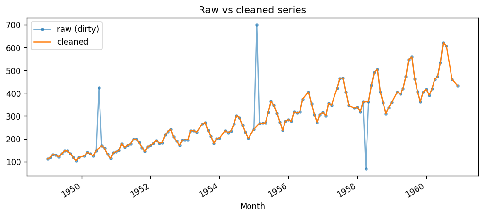

# Time Series Data Cleaning

A Python toolkit and set of notebooks for cleaning time series data: duplicates, missing timestamps, missing values, outliers, resampling and timezones.

## Overview
Real-world time series are messy. This project walks through a complete cleaning workflow on a monthly dataset and packages the reusable steps into `src/cleaning.py`.

**Objectives**
- Diagnose data quality problems
- Compare strategies for filling missing values
- Detect and treat outliers with several methods
- Resample, smooth and handle timezones
- Produce a clean, reusable dataset

## Dataset
Monthly international airline passengers (1949-1960), 144 observations, from the public [jbrownlee/Datasets](https://github.com/jbrownlee/Datasets) repository (`data/raw/airline-passengers.csv`).
Because the original is already clean, `src/make_dirty_data.py` creates `airline_passengers_dirty.csv` with injected problems: 8 missing values, 3 outliers, 2 missing months, 2 duplicate rows and shuffled order. **The messiness is synthetic and added for practice.**

## Project structure
```
data/raw/        original and dirty data
data/cleaned/    cleaned output
notebooks/       01 exploration, 02 missing values, 03 outliers, 04 resampling
src/             cleaning.py (reusable functions), make_dirty_data.py
images/          figures used in this README
```

## Installation
```bash
git clone https://github.com/<your-username>/time-series-data-cleaning.git
cd time-series-data-cleaning
pip install -r requirements.txt
```

## Usage
```bash
python src/make_dirty_data.py   # optional: regenerate the dirty dataset
jupyter notebook                # open notebooks/ and run in order 01 -> 04
```
Or use the functions directly:
```python
from src import cleaning as cl
clean = cl.clean_pipeline("data/raw/airline_passengers_dirty.csv")
```

## Techniques covered
- Datetime parsing, indexing, duplicate and gap detection
- Missing values: forward fill, backward fill, linear and time interpolation
- Outliers: Z-score, IQR, rolling median (MAD)
- Rolling-mean smoothing
- Resampling (quarterly, yearly)
- Timezone localization and conversion

## Results
- Rolling-median detection found all 3 injected outliers; Z-score and IQR found only 1, because they ignore trend and seasonality.
- Time interpolation filled gaps more naturally than ffill/bfill, which create flat steps.



## Future work
- Add seasonal decomposition-based outlier detection
- Add unit tests for `cleaning.py`
- Try other datasets (sensor, stock) and irregular frequencies

## License and author
MIT License. Author: YOUR NAME ([GitHub](https://github.com/<your-username>))
